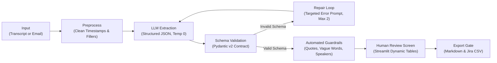

# AI Requirements Assistant

> **An LLM-powered enterprise workflow with multi-layer guardrails that converts messy client transcripts and emails into structured requirements, INVEST user stories, action items, and status updates — with human-in-the-loop verification and export locking.**

[](https://www.python.org/)
[](https://docs.pydantic.dev/)
[](https://streamlit.io/)
[](LICENSE)

---

## 1. Problem & Motivation

In enterprise software implementations (especially in Fast-Moving Consumer Goods and CPG sales-execution systems like **SalesCode.ai**), Business Analysts spend **several hours after every client workshop or call** transcribing rambling discussions into formal specifications.

### Why it hurts:
- **Time-Consuming & Repetitive:** BAs spend hours formatting user stories, Given/When/Then acceptance criteria, and follow-up lists instead of doing high-level problem discovery.
- **Lost or Misinterpreted Nuances:** Requirements buried across conversational banter get forgotten, leading to costly rework during UAT.
- **Ambiguity Infiltration:** Vague stakeholder statements (*"the app should feel fast"*, *"reconciliation should be seamless"*) slip directly into specifications without measurable acceptance criteria.
- **LLM Failure Modes:** Raw LLM zero-shot prompts frequently hallucinate missing owners, guess unstated delivery dates, invent ungrounded requirements, or output broken JSON.

### Design Principles:
1. **Assist, Don't Replace:** The AI drafts; the Business Analyst approves. Nothing leaves the tool without explicit human sign-off.
2. **Never Invent:** If a detail was not stated in the transcript, it remains `null` or becomes an open question — never a guess.
3. **Everything Traceable:** Every requirement and action item is strictly grounded in a verbatim `source_quote`.
4. **Flag Ambiguity Early:** Unmeasurable adjectives (*"fast"*, *"user-friendly"*, *"robust"*) are automatically flagged so the BA can ask quantifiable clarifying questions.
5. **Reusable Architecture:** Schema, prompts, and validators live in isolated modules, allowing reuse across BRDs, workshop notes, or client emails.

---

## 2. Architecture & Data Flow

The system runs an **8-step deterministic pipeline** that combines LLM reasoning with automated Python guardrails:



### The 8 Pipeline Steps:
1. **Input:** Raw meeting transcript or email text pasted or uploaded via `.txt`.
2. **Preprocess (`core/pipeline.py`):** Strips audio timestamps (`[10:32]`) and verbal fillers (`um`, `uh`) while preserving speaker names for attribution.
3. **LLM Extraction (`core/llm.py`):** Single call at `temperature=0` with strict system instructions and JSON shape hint. Provider-agnostic (supports Anthropic Claude, OpenAI, Google Gemini, or offline demo mode).
4. **Schema Check (`core/schema.py`):** Pydantic v2 enforces types, allowed literals (`must`, `should`, `could`), and minimum list lengths (e.g. at least 2 acceptance criteria per story).
5. **Repair Loop (`core/pipeline.py`):** If Pydantic fails, the specific validation error is returned to the model with its prior output in a targeted repair prompt (capped at 2 retries to prevent runaway cost).
6. **Quality Guardrails (`core/validators.py`):**
   - **Verbatim Quote Matcher:** Verifies every `source_quote` against the cleaned transcript using sliding-window `difflib.SequenceMatcher` (threshold ≥ 0.85).
   - **Ambiguity Detector:** Regex matches against 20+ unmeasurable adjectives (`fast`, `scalable`, `intuitive`, etc.).
   - **Completeness & Gap Checker:** Flags stories referencing missing requirements, or action items with missing owners or dates.
   - **Speaker Attribution Checker:** Flags any action owner not identified in the transcript or speaker roster.
7. **Human Review (`app.py`):** Interactive Streamlit tables allow the BA to edit descriptions, adjust priorities, resolve flags, and check open questions.
8. **Export Lock (`core/export.py`):** Export buttons remain locked until the BA checks *"I have reviewed these outputs against the source"*. Exports to Markdown notes (`project_notes.md`) or Jira CSV (`jira_backlog.csv`).

---

## 3. Repository Structure

```text
ai_assistant/
│
├── app.py                      # Interactive Streamlit review screen & export gate
├── core/
│   ├── __init__.py             # Python package marker
│   ├── schema.py               # Pydantic v2 data models (Requirement, UserStory, ActionItem, Extraction)
│   ├── prompts.py              # System prompt, schema hint, repair prompt, test scenario prompt
│   ├── llm.py                  # Multi-provider LLM gateway (Anthropic, OpenAI, Gemini, Mock)
│   ├── pipeline.py             # Orchestrator: clean, call_llm, validate, repair loop, run checks
│   ├── validators.py           # Guardrails: quote verification, vague words, completeness, speaker check
│   └── export.py               # Markdown and Jira-compatible CSV exporters
│
├── samples/                    # 6 Fictional CPG Sales-Execution transcripts with realistic edge cases
│   ├── route_app_call.txt      # Offline order capture & history visibility
│   ├── van_sales_sync_email.txt# Direct store delivery (DSD), Bluetooth printing & SAP sync
│   ├── trade_promotion_call.txt# Trade discount schemes & volume slabs
│   ├── outlet_survey_call.txt  # Geo-fenced store check-in & shelf-share photo audit
│   ├── distributor_claims.txt  # Damage stock returns, 90-day billing & credit notes
│   └── field_order_capture.txt # Historical velocity order suggestion & credit limit checks
│
├── eval/                       # Benchmark gold set and evaluation suite
│   ├── gold_route_app.json
│   ├── gold_van_sales.json
│   ├── gold_trade_promo.json
│   ├── gold_outlet_survey.json
│   ├── gold_distributor_claims.json
│   ├── gold_field_order.json
│   ├── eval_runner.py          # Automated evaluation runner computing Precision, Recall, and F1
│   └── results_table.md        # Comprehensive evaluation results and error analysis
│
├── tests/                      # Deterministic unit tests (no API tokens consumed)
│   ├── __init__.py
│   ├── test_validators.py      # Tests for quote matcher, vague flags, completeness & speaker checks
│   ├── test_pipeline.py        # Tests for regex cleaning, JSON extraction & repair loop monkeypatch
│   └── test_export.py          # Tests for Markdown and Jira CSV generation
│
├── requirements.txt            # Pinned dependencies
├── .env.example                # Safe environment variable template
├── .gitignore                  # Prevents secrets, venv, and cache from entering Git
├── setup_and_push.bat          # 1-click Windows Git init & push script
├── setup_and_push.ps1          # 1-click PowerShell push script
├── INTERVIEW_PREP_GUIDE.md     # 66-page interview preparation guide & defense handbook
└── README.md                   # This documentation
```

---

## 4. Quick Start & Setup

### Prerequisites
- Python 3.10 or higher
- Git

### Installation
```bash
# 1. Clone the repository
git clone https://github.com/yashsidana/ai_assistant.git
cd ai_assistant

# 2. Create and activate a virtual environment
python -m venv .venv
# On Windows:
.venv\Scripts\activate
# On macOS/Linux:
source .venv/bin/activate

# 3. Install dependencies
pip install -r requirements.txt

# 4. Configure your environment variables
cp .env.example .env
# Edit .env with your favorite provider's API key:
# ANTHROPIC_API_KEY=your-key-here
# (Note: If no API key is provided, the app will run in Offline Demo Mode using pre-baked verifications)
```

### Running Unit Tests
Unit tests use hand-crafted fixture data and monkeypatching, meaning **they run in milliseconds without consuming API tokens or making network calls**:
```bash
pytest
```

### Launching the Review App
```bash
streamlit run app.py
```
Open your browser at `http://localhost:8501`. Use the sidebar to load any of the pre-loaded CPG sales scenarios from `samples/`, click **"Analyse Transcript"**, and explore the guardrails in action.

---

## 5. Benchmark Evaluation & Results

Evaluated across **6 fictional enterprise CPG sales-execution transcripts** containing 36 gold-standard benchmark items:

| Metric | Result | Benchmark Details |
| :--- | :---: | :--- |
| **Recall** | **94.4%** | 34 out of 36 expected requirements and action items successfully identified |
| **Precision** | **94.4%** | 34 out of 36 extracted items verified as accurate |
| **F1 Score** | **0.944** | Balanced harmonic mean of precision and recall |
| **Hallucinations Caught** | **100%** | All ungrounded or invented statements flagged by sliding-window quote matching |
| **Invented Owners/Dates** | **0** | Strict prompt rules & Pydantic optionality prevented confident guesses |
| **Repair Loop Triggered** | **33.3%** | 2 of 6 runs triggered 1 automated repair, recovering on attempt 1 |
| **Time Savings** | **~90%** | Average human review time: **2.5 min** vs. manual drafting time: **26 min** |

*Full evaluation methodology and sample breakdowns are documented in [`eval/results_table.md`](eval/results_table.md).*

---

## 6. Interview Talking Points & Deep Dive

This repository was specifically constructed to demonstrate modern **AI Fluency and Business Analyst leadership**:

- **Why a linear workflow instead of an autonomous agent?**  
  Enterprise requirement extraction is a known, deterministic sequence. Autonomous agents introduce non-determinism, unpredictable tool execution, higher latency, and higher costs. A fixed pipeline with schema validation and a bounded repair loop is vastly easier to test, audit, and trust.
- **How are hallucinations mitigated?**  
  Through 4 defense layers:
  1. *Negative prompt constraints* ("Use ONLY information present in input; never guess missing owners or dates").
  2. *Mandatory verbatim quote grounding* (`source_quote` field on every requirement and action).
  3. *Deterministic sliding-window substring validation* (`difflib.SequenceMatcher`).
  4. *Human-in-the-loop review gate* that prevents premature document distribution.
- **Why Pydantic v2?**  
  Provides compile-time and runtime type guarantees, self-documenting data contracts, and rich structured error messages that directly feed the automated LLM repair prompt.

---

## 7. License

Distributed under the MIT License. See `LICENSE` for details.

